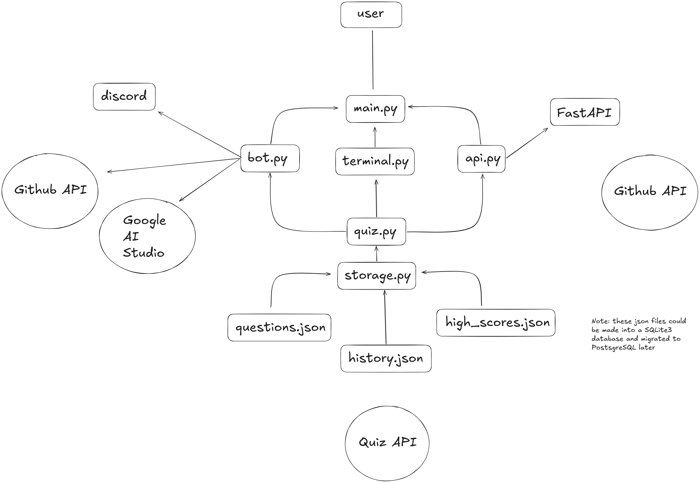

# Professor Quack.py

Professor Quack is a quiz and review platform for Marcy SWE Fellows, it is available in three branches — as a CLI application, as a Discord bot and as an API. It quizzes multiple-choice questions on content covered in the Python version of the SWE Gitbook.

Eventually this platform will expand to include new technologies, languages and tooling as well as schedule reviews with FSRS. It'll also match fellows to review each other's pull requests.

Please note for grading purposes, only interact with the CLI terminal view. Furthermore, a lot of features were attempted and some at varying states of completion.

## Installation

Having issues getting this repository set up? Refer to this quick walk-through, if you are still experencing problems feel free to create an issue in the repository  and report your problem!

### Requirements

- Python 3.12 or newer (developed on Python 3.14)
- Git

### 1. Clone the repository and move into it

   ```bash
   git clone https://github.com/oswwwaldo/professor-quack-py.git
   cd professor-quack-py
   ```

### 2. Create and activate a virtual environment

   Windows (PowerShell)

   ```powershell
   python -m venv .venv
   .venv\Scripts\Activate.ps1
   ```

   macOS / Linux

   ```bash
   python3 -m venv .venv
   source .venv/bin/activate
   ```

### 3. Install the dependencies

   ```bash
   python -m pip install -r requirements.txt
   ```

### 4. Profit


## Running the quiz

```bash
python main.py
```

On macOS or Linux, use `python3` if `python` isn't found.

Choose options by typing their number and pressing Enter. To use the arrow keys instead, open **Settings** and switch controllers. Arrow-key mode works in most modern terminals, including Windows Terminal and VS Code's terminal though keep in mind that this mode is not fully supported yet.

## Running the tests

```bash
python -m pytest
```

## Discord bot (optional)

To run the Discord bot, copy `.env.example` to `.env` and fill in your bot token and server IDs. The file explains where to find each value.

Keep in mind this is a pending feature that is not ready for playtesting.

## FastAPI server (optional)

To start the API view specifically, please run `uvicorn api:app --reload`

Keep in mind this is a pending feature that does not represent the intended finished product

## Roadmap

### Phase 0 (finished)

MVP, finish quiz features, categories, difficulty and a timer base

### Phase 1 (currently -> Dec 1st)

Refactoring, polishing and adding new features with OOP-first programming, more extensive pytests. A DESIGN.md and UML diagrams should be sketched in advance.

Should be ready or already implement sockets for multiplayer or at least sending messages in between different CLI clients.

Collect data and feedback on early iterations to test whether this could work as software people would use/find helpful. Re-evaulate future plans based on findings.

### Phase 2 (post Jan 12th -> February)

FastAPI, Pydnatic models, Docker and a GitHub Actions pipeline.

### Phase 3 (undefined timeline)

Discord on workers, D1, cron announcements, PR matchmaker.

### Phase 4 (undefined timeline)

FSRS reviews, live rooms, Pico quiz station + dispenser

## Why is this repository called Professor Quack.py?

Because.

## What is this project?

It is a quiz application meant to help fellows at the Marcy Lab School learn more about Gitbook-covered material. The questions were generated using Claude to be relevant and on varying degrees of difficulty and categories.

I am still looking into whether this project could be genuinely useful for my target audience but in the future I think I'd like to add some kind of physical station with a Raspberry Pico machine. The API porition of this project is an endpoint for that machine to work with over the internet and the discord bot is meant to be a friendly and easy way to get into 'Professor Quack'.

I will look into conducting qualitive surveys and interviews to gauge how much of an investment this project should cost me over my year at the Marcy Lab.

If this does work out as software long-term, this could be helpful for other fellows in contributing to OSS. Either through documentation, code, new features, their own forked projects or contributing to the question bank.

## Design principles

- YAGNI — you aren't going to need it

- DRY — don't repeat yourself

- Atomic pure functions

- Write deep modules with rich functionality hidden behind simple and shallow interfaces

- Common sense and prioritize common use cases

A function earns its place when it... names an intent, hides an edge case, is testable and gives you one place to change behavior

## Overview



All of the application's data originates from storage.py, which at the moment pulls data from three different JSON files. Quiz API was called before in the development of this program but remains disconnected from the loop for now.

`quiz.py` handles all the core data-related functions and represents the base of the application. It would be considered the brain in the larger context of this application.

`bot.py` is the view dedicated for starting and running a Discord bot.

`terminal.py` is the view dedicated for running in the command line.

`api.py` is the view dedicated for serving an API for clients, this would be the jumping off point for either our discord bot or other views such as a website or as a Raspberry Pi machine.

`main.py` is the actual organ connecting everything to the program and to the user. It is what allows a user to select which views to start from, within the CLI.

## Features for the future

Two additional views are being considered in addition to what we already have — that being as a website and as a Raspberry Pico machine.

The API component for this reason is essential to both stations even if we only go with one or none of them at all.

I am also considering connecting Quiz API and other open source quiz banks to supply additional question to the base since at the moment, the questions.json was generated using Claude. While the project will always deal with technology first, other categories of questions will be supported.

Repurposing Anki cards into Python objects is also being considered though is a stretch goal.

I'd like to learn Cloudflare workers and edge computing more thoroughly so some kind of live rooms feature or webhook/queue would help.

### Core

- Multiple-choice questions
- Score display (for example, `2/3 (67%)`)
- High score tracking
- Top-five high score board saved to JSON
- Show answered questions
- Show answered correctly questions
- Show answered incorrectly questions
- Track question history (build a list of correct/incorrect questions).

### Categories and Difficulty

- Add category and difficulty fields to each question dictionary.
- Filter the question list by category and difficulty.
- Remove questions from review/study

### Timer

- CLI and Discord bot feature only
- Already present in CLI via `death_match()`
- Use the `discord.py` view `on_timeout` method.

### Announcements

- Discord bot feature only
- Use `discord.ext.tasks` to run a loop once a day.
- Check dates and leaderboard information.
- Post updates in the respective channel:
  - F26 SWE Landing Page → `#all-swe`
  - Allagi L&D Landing Page → `#swe-allagi`
  - Coaching Landing Page → `#swe-telos`
- Post 'study reminders' in advance whenever a next chapter of the Gitbook is due a day prior

### Code Challenges

- Discord bot feature only
- Codewars, HackerRank, etc.
- A random multiple choice question or link to a Codewar/HackerRank/Leetcode problem

### Pull Request Reviewer

Exclusively on the Discord bot, this would help fellows find people to review their code on discord.

- Discord bot feature only
- GitHub webhooks or API
- Would systematically help build GitHub streaks and reinforce a commitment to programming over the long-term
- i.e `/pr https://github.com/oswwwaldo/professor-quack-py/pull/3`
- i.e `!check https://github.com/oswwwaldo/professor-quack-py7`

### Explain Code

- CLI and discord bot feature only
- Google AI Studio API calls
- i.e `/explain Why Python considers '' in every string`

### Cloudflare bucket list

- A worker as discord's interactions endpoint, check request signatures
- A py worker running the ASGI app
- One durable object per room over web sockets
- D1 with hot question sets cached in KV
- Cron triggers
- Webhook worker -> queue -> consumer
- Workers AI, or AI gateway in front of AI studio
- Rate limiting rules, WAF and turnstile
- Hyperdrive

### Technologies and Tools

- Pydantic
- pytest
- GitHub Actions
- PostgreSQL
- FastAPI
- Docker
- Google AI Studio
- Wrangler / Cloudflare Workers

- Anki decks (repurposing)
- QuizAPI.io, Codewars, HackerRank

## Planned Slash Commands

- `/help`
- `/quiz`
- `/rankings`
- `/review`
- `/board`
- `/explain`
- `/quack`

## Source TO Pull From

[Google Doc](https://docs.google.com/document/d/1HDtu0-PQcvYO4X-RIxT8mjOcsxf3cgXGdFPtXZN7QDM)
