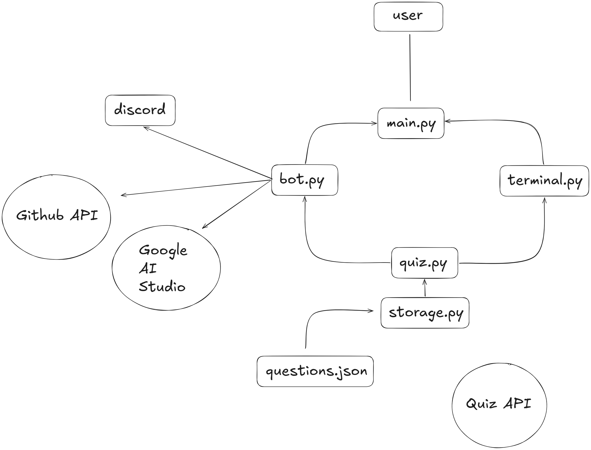

# Professor Quack.py

A discord bot with quiz, pull request matchmaking, code challenging and LLM functionality. It's a bot with a personality—he's also a duck.

## Design principles

* YAGNI — you aren't going to need it

* DRY — don't repeat yourself

* Atomic pure functions

* Write deep modules with rich functionality hidden behind simple and shallow interfaces

* Common sense and prioritize common use cases

A function earns its place when it... names an intent, hides an edge case, is testable and gives you one place to change behavior

'Death' match round where you must answer questions as quickly as possible within a timer this determines your high score'

You need to track question history, and build a list of questions that's been answered either correctly or incorrectly and attach it
to the player state, but that is beyond the MVP so maybe for the future...

## Overview

The app communicates either as a CLI terminal application or as a discord bot (with added functionality)

To start the API view, please run `uvicorn api:app --reload`

## Core

* Multiple-choice questions
* Score display (for example, `2/3 (67%)`)
* High score tracking
* Top-five high score board saved to JSON
* Show answered questions
* Show answered correctly questions
* Show answered incorrectly questions

## Categories and Difficulty

* Add category and difficulty fields to each question dictionary.
* Filter the question list by category and difficulty.
* Remove questions from review/study

## Timer

* Use the `discord.py` view `on_timeout` method.

## Announcements

* Use `discord.ext.tasks` to run a loop once a day.
* Check dates and leaderboard information.
* Post updates in the respective channel:
  * F26 SWE Landing Page → `#all-swe`
  * Allagi L&D Landing Page → `#swe-allagi`
  * Coaching Landing Page → `#swe-telos`

## Code Challenges

* Codewars, HackerRank, etc.

## Pull Request Reviewer

* GitHub webhooks or API

## Explain Code

* Google AI Studio API calls

## Technologies and Tools

* Pydantic
* Docker
* pytest
* GitHub Actions
* Google AI Studio
* Cloudflare Workers
* Anki
* QuizAPI.io
* FastAPI

## Answer Matching

* Use the Levenshtein algorithm to handle possible answer mismatches, such as extra whitespace in a question or answer.

## Slash Commands

* `/help`
* `/quiz`
* `/rankings`
* `/review`
* `/board`
* `/explain`
* `/quack`

## Source

[Google Doc](https://docs.google.com/document/d/1HDtu0-PQcvYO4X-RIxT8mjOcsxf3cgXGdFPtXZN7QDM)
